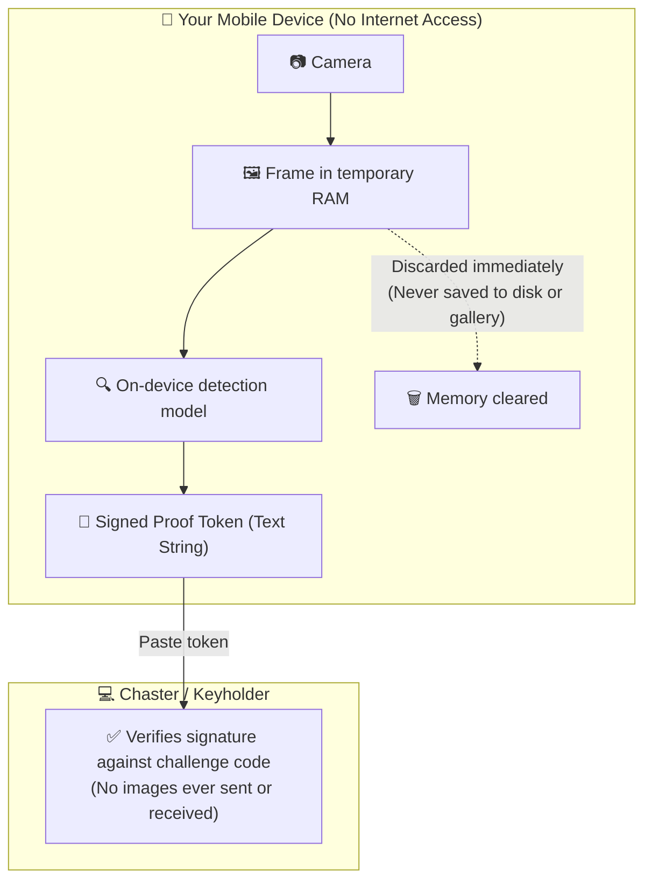

# Local Verification (`LV`)

<p align="center">
  <strong>On-Device Chastity Verification · No Network Access · Privacy-First</strong>
</p>

<p align="center">
  
  
  
  
</p>

---

## What is LV?

**Local Verification (`LV`)** is an experimental mobile tool that verifies chastity compliance locally on your phone without sending photos to any server, cloud service, or third party.

Instead of uploading pictures, the app runs a lightweight computer vision model directly on your device, confirms the lock is secured, and generates a signed text code (**proof token**) that you can share with your keyholder or paste into the Chaster extension.



---

## Who is this for (and who is it NOT for)?

### 👍 Good fits:
* **Wearers with strict privacy needs:** If your job, living situation, or personal boundaries mean you cannot have sensitive photos stored on your device or transmitted over the internet.
* **Solo wearers & streak challenges:** If you lock yourself (or participate in events like Locktober) and want an objective check-in mechanism to keep yourself accountable without relying on manual self-reporting.
* **High-frequency check-in schedules:** If you or your keyholder want check-ins every few hours (e.g. while at work or traveling), but don't want to spam your keyholder's inbox with repetitive photos throughout the day.
* **Offline travel:** When you are camping, flying, or without reliable cellular service, the app can run a schedule of checks offline and bundle them for submission when you're back online.

### 🛑 Not intended for:
* **Replacing human trust and intimacy in a D/s dynamic:** For many couples, the photo exchange is an essential part of the relationship, vulnerability, and play. If you and your keyholder have established trust and enjoy that interaction, this tool is not meant to replace that.
* **High-stakes enforcement without human oversight:** On-device computer vision is not 100% foolproof. Poor lighting, unusual cage geometries, or heavy shadows can lead to failed checks. We recommend pairing automated checks with periodic human reviews.

> ⚠️ **Project Status:** The computer vision model is an **early baseline prototype**. We are sharing this early to gather community feedback and determine whether there is sufficient interest before investing in larger dataset collection and dedicated seal verification.

---

## Privacy & Security: How It Actually Works

We deliberately avoid marketing buzzwords. Here is exactly how the app protects your privacy:

### 1. No Internet Permission
The application is built without network capabilities. In Android's manifest (`AndroidManifest.xml`), `android.permission.INTERNET` is **omitted entirely**. The mobile operating system physically blocks the app from making network connections, opening web sockets, or transferring data.

You can verify this yourself using any APK inspection tool (see instructions below).

### 2. No Photos Persisted to Disk
When you take a picture for verification:
* The camera frame is held in volatile app memory (`RAM`) only while the model evaluates it.
* Once the check completes, the image buffer is dropped.
* The image is **never** written to your camera roll, photo gallery, temporary cache, or internal storage. Even if a check fails, no image file remains on your device.

### 3. Verification by Mathematical Signature, Not Photos
Instead of transmitting an image, the app computes an **HMAC-SHA256 signature** using a shared secret and a one-time challenge code. 

The resulting proof string proves that:
1. The on-device model evaluated a locked device.
2. The check occurred during the active session.
3. The response matches the requested challenge code.

Your keyholder or the Chaster extension can verify this mathematical signature in seconds without ever having an image file exist.

---

## 📥 Download & Independent Verification

Signed release APKs are hosted on the [Releases](https://github.com/osepam-netizen/lv/releases) page.

### How to verify the APK has no internet access:
You don't need to trust our code. You can verify the APK yourself using independent tools:

1. Download the APK from [Releases](https://github.com/osepam-netizen/lv/releases/latest).
2. Visit an online APK inspector such as **[betadrop.app/apk-inspector](https://betadrop.app/apk-inspector/)** or use the Android command line:
   ```bash
   aapt dump permissions lv-vX.Y.Z.apk
   ```
3. Look at the requested permissions list:
   - Notice that `android.permission.INTERNET` is **not present**.
   - The OS enforces this barrier at the kernel level.

---

## 🚀 How to Use

### Single Verification Check
1. **Get your challenge code:** From the Chaster extension or your keyholder, get your current verification code (or scan the verification QR code).
2. **Open LV:** Tap **Scan Chaster QR** (or enter the key and 6-digit challenge code manually).
3. **Align camera:** Hold the camera so your locked device is clearly visible under good lighting.
4. **Capture:** Tap the shutter button. The app evaluates the image locally in 1–2 seconds.
5. **Submit proof:** Copy the generated proof token and paste it back into the Chaster extension.

---

## ⏱️ Offline Periodic Verification (Batch Mode)

For situations where you are away from your computer or traveling without connection, the app supports **Offline Sessions** on the **Offline Session** tab:

1. **Hardware-backed timers:** The countdown timer between checks is tied to your phone's physical hardware uptime (time elapsed since boot), not the system clock. Changing your phone's date or time settings will not bypass the interval lock.
2. **Sequential verification chaining:** Each check embeds the cryptographic hash of the previous check, ensuring checks are completed in order and cannot be pre-recorded or skipped.
3. **Batch submission:** At the end of the day or trip, tap **Copy Batch** to export all completed checks in a single string for your keyholder or extension to validate.

### Try an instant 1-minute demo:
Scan this QR code with the LV app (or open the link) to test a quick 3-check demo without waiting hours:

<p align="center">
  <br/>
  <em>Scan directly in LV app ("Scan Chaster QR" button)</em>
</p>

```text
lv://verify?session_id=demo_quick_test&interval_m=1&total_checks=3&min_conf=0.60&deadline_ts=1893456000&type=male_cage_padlock
```

> 📖 For full technical details on periodic sessions, see [docs/OFFLINE_VERIFICATION.md](docs/OFFLINE_VERIFICATION.md).

---

## ❓ Frequently Asked Questions (FAQ)

<details>
<summary><strong>Does this app replace my keyholder?</strong></summary>

**No.** This app is an optional utility. It does not replace the communication, trust, or dynamic between a wearer and a keyholder. Many users use it for secondary check-ins (e.g. automated 4-hour daytime intervals), while keeping a daily human photo or video check-in with their partner in the evening.
</details>

<details>
<summary><strong>Why not just crop my face and tattoos out of regular photos?</strong></summary>

For many wearers, manual cropping works well and is all they need. However:
1. Cropping still leaves sensitive photos on your phone's camera roll or deleted folder.
2. Accidents happen (wrong file selected, cloud backup syncs before editing, etc.).
3. Some wearers are simply uncomfortable with any sensitive media existing on their device at all.
If you are already satisfied with manual cropping, you might not need this app.
</details>

<details>
<summary><strong>Can keyholders, Chaster, or the developers see my photos?</strong></summary>

**No.** The app has no internet permission, so it cannot communicate with any remote server. Frames are processed in device RAM and discarded immediately. No images ever leave your phone.
</details>

<details>
<summary><strong>What if the model doesn't recognize my cage?</strong></summary>

Vision models depend heavily on lighting, contrast, and angle. Ensure good lighting and a clean background. If your device has an unusual custom design or silicone sleeve, the baseline model might struggle. We are exploring support for **numbered tamper-evident seals** as a more reliable and standardized alternative.
</details>

<details>
<summary><strong>Can someone trick the timer by changing the phone's clock?</strong></summary>

**No.** Periodic checks measure elapsed hardware uptime (CPU ticks since boot, including sleep mode). Adjusting the date, time, or timezone in Android or iOS settings does not alter the hardware counter.
</details>

---

## 📜 License

Distributed under the MIT License. See [LICENSE](LICENSE) for details.
