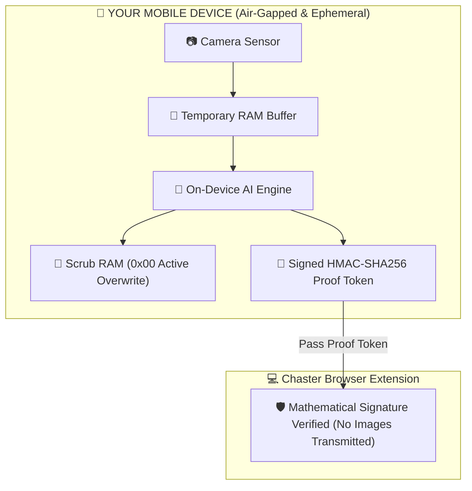

# Local Verification (`LV`) Mobile App

<p align="center">
  <strong>100% Air-Gapped · On-Device AI · Zero-Knowledge Chastity Verification</strong>
</p>

<p align="center">
  
  
  
  
</p>

---

## 🛡️ The Zero-Knowledge Privacy Guarantee

**Local Verification (`LV`)** is an offline verification utility designed for wearers of chastity devices who want absolute certainty that **no intimate photos or videos can ever be stored, leaked, or sent to a server**.



### 1. 📴 Physically Air-Gapped (Zero Internet Permission)
The app is built without network capability. In the application manifest (`AndroidManifest.xml`), the standard `android.permission.INTERNET` permission is **completely absent**. The mobile operating system physically blocks the app from creating any socket, HTTP, or network connections.

### 2. 🧼 Ephemeral RAM Scrubbing
Camera frames reside strictly in temporary volatile RAM. Immediately upon running on-device inference, the memory buffer is actively overwritten with all zeros (`0x00`) using cryptographic memory scrubbing before being deallocated.

### 3. 🚫 Zero Local Storage
The app does **not** save photos to the camera roll, photo gallery, temporary cache, or filesystem. Even if verification fails or an inspection error occurs, no imagery is ever persisted.

### 4. 🔐 Cryptographic Proofs
Rather than uploading pictures, `LV` generates a tamper-proof **HMAC-SHA256 signed attestation token**. The Chaster browser extension validates the mathematical signature using your shared secret key without ever needing to see your photos.

---

## 📥 Download & Installation

Official pre-built, signed release APKs are hosted directly in the [Releases](https://github.com/osepam-netizen/lv/releases) section of this repository.

### Quick Install (Android)
1. Navigate to [Releases](https://github.com/osepam-netizen/lv/releases/latest).
2. Download the latest `lv-vX.Y.Z.apk`.
3. Open the downloaded file on your Android device and confirm installation.

### Verify SHA-256 Checksum (Optional)
To verify the integrity of the downloaded file:
```bash
# On macOS / Linux:
sha256sum lv-vX.Y.Z.apk
# Compare the output with lv-vX.Y.Z.apk.sha256 from the release page
```

### Verify No Internet Permission (Audit)
You can independently inspect the APK to confirm that zero internet permissions are requested:
```bash
aapt dump permissions lv-vX.Y.Z.apk
# Output will confirm that android.permission.INTERNET is NOT present!
```

---

## 🚀 Step-by-Step User Guide

### Step 1: Scan or Enter Your Lock Session Token & Challenge Code
When a check-in is required, the Chaster extension displays a unique 6-digit challenge code and session key (or a single verification QR code).

On the **Verify** tab in the LV mobile app:
- Tap **Scan Chaster QR (Auto-Fill Both)** to automatically populate both your session token and 6-digit challenge code in one tap, **OR**
- Paste your extension token into the **Extension Token / Secret Key** field (it will be automatically remembered for this lock session) and enter the 6-digit challenge code.

### Step 2: Prepare Your Handwritten Challenge Code
Write the 6-digit challenge code on a piece of paper or your skin so it can be verified in the camera viewfinder alongside your device.

### Step 3: Run On-Device Verification
1. On the **Verify** tab, select your device profile:
   - **Male Chastity Cage** (Built-in Lock or Padlock)
   - **Female Chastity Belt** (Built-in Lock or Padlock)
2. Tap **Start Camera Inspection**.
3. Align the camera viewfinder so that your locked device and handwritten challenge code are clearly visible.
4. Tap the capture button.

### Step 4: Live On-Device Analysis
The app switches to the analyzing screen with an animated status indicator:
1. *Scans for handwritten 6-digit challenge code via local OCR.*
2. *Inspects device presence and locked padlock engagement via LiteRT neural engine.*
3. *Enforces anti-cheating & live scene checks (rejects photos of screens/monitors, printed photos, open shackles, inserted keys, or unworn loose hardware).*
4. *Signs the verification result with HMAC-SHA256.*

### Step 5: Submit Verification to Chaster
Once verified, the full-screen **Verification Result** page displays:
- An **HMAC-SHA256 Proof Token**.

**To submit:**
- Tap **Copy** and paste the proof token string into the Chaster extension input field.

The Chaster extension verifies the signature instantly and clears your verification check-in!

---

## ⏱️ Offline Periodic Sessions (Air-Gapped Batch Mode)

For long-term offline periods (e.g. traveling, sleeping, or away from a computer), `LV` supports multi-check **Offline Verification Sessions** located on the **Offline Session** tab:

1. **Hardware Monotonic Lock**: The app reads direct hardware uptime counters (measuring genuine physical time since boot, including sleep). Changing device date/time in OS Settings cannot bypass the interval lock.
2. **Cryptographic Hash Chaining**: Every check embeds the SHA-256 hash of the previous check, ensuring proofs cannot be reordered or forged.
3. **Batch Export**: Once checks are completed, tap **Copy Batch** to export a signed verification bundle directly to Chaster.

### 🧪 Try an Instant Demo Session
To test offline verification on your device without waiting hours, point the LV app scanner at this QR code or copy the test link:

<p align="center">
  <br/>
  <em>Scan directly with the LV App ("Scan Chaster QR" button)</em>
</p>

```text
lv://verify?session_id=demo_quick_test&interval_m=1&total_checks=3&min_conf=0.60&deadline_ts=1893456000&type=male_cage_padlock
```
*In the app: tap **Scan Chaster QR** on Tab 1 or go to **Offline Session** $\rightarrow$ tap **Scan Session QR Code**.*

> 📖 **Full Guide & Security Architecture**: See [docs/OFFLINE_VERIFICATION.md](docs/OFFLINE_VERIFICATION.md) for full protocol specifications and additional test links.

---

## 🔍 Hardware & Compliance Profiles

| Device Profile | Required Verification State | Immediate Security Violations |
| :--- | :--- | :--- |
| **Male Cage (Padlock)** | Device properly worn + Padlock shackle fully closed | Open padlock, key inserted in lock, unworn loose device, unlocked anatomy, or screen/photo spoof |
| **Male Cage (Built-in)** | Device properly worn with internal lock cylinder engaged | Key inserted in lock, unworn loose device, unlocked anatomy, or screen/photo spoof |
| **Female Belt (Padlock)** | Belt properly worn + Padlock shackle fully closed | Open padlock, key inserted in lock, unworn loose device, unlocked anatomy, or screen/photo spoof |
| **Female Belt (Built-in)** | Belt properly worn with built-in closure locked | Key inserted in lock, unworn loose device, unlocked anatomy, or screen/photo spoof |

---

## ❓ Frequently Asked Questions (FAQ)

<details>
<summary><strong>Can keyholders or Chaster admins see my verification photos?</strong></summary>

**No. It is technically impossible.** The application has no internet access, and images are scrubbed from RAM immediately after analysis. Neither Chaster, nor your keyholder, nor the app developers receive any images.
</details>

<details>
<summary><strong>What if my challenge code isn't recognized?</strong></summary>

Make sure the code is written in bold, clear numbers with high contrast (dark marker on white paper or skin) and that your room is well lit.
</details>

<details>
<summary><strong>Can this be used on an airplane or without cellular service?</strong></summary>

**Yes!** The application is 100% offline. You do not need Wi-Fi or cellular reception to run verification.
</details>

<details>
<summary><strong>Can someone cheat periodic checks by changing the date or time on their phone?</strong></summary>

**No.** The app enforces check intervals using a hardware uptime clock. This counter measures genuine hardware CPU ticks and deep-sleep time; changing the phone's date, time, or timezone in system settings has zero effect on the countdown lock.
</details>

---

## 📜 License

Licensed under the MIT License. See [LICENSE](LICENSE) for details.
