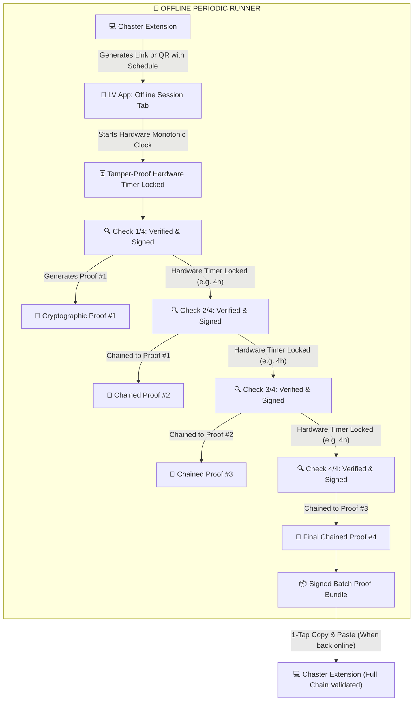

# Offline Periodic Verification & Batch Chaining Guide

This guide explains how **Local Verification (`LV`)** performs offline, periodic chastity compliance verification sessions without requiring active internet connectivity or immediate access to the Chaster web extension.

---

## 🔒 What is an Offline Verification Session?

Normally, wearers perform single-check verifications on demand by copying an OTP code from Chaster into the app and scanning a proof token back into the web extension.

In an **Offline Verification Session**, wearers can execute a multi-stage periodic verification schedule completely air-gapped (e.g. while traveling, on an airplane, sleeping, or away from a computer), and subsequently upload a single, cryptographically signed batch bundle back to Chaster.



---

## 🛡️ Anti-Cheat & Security Guarantees

### 1. Hardware Monotonic Clock (Tamper-Proof Timers)
Standard phone clocks can be rolled forward or backward in device settings to fake elapsed time. To eliminate this vector, the app reads the device's **hardware uptime counter** (milliseconds since the physical device booted, including low-power sleep modes).

Changing system dates, times, or timezones in iOS or Android settings has **zero effect** on this hardware counter. The next check cannot be unlocked until the genuine physical duration has passed.

### 2. Cryptographic Hash Chaining
Every check is mathematically chained to the check before it:
- Each proof includes the SHA-256 digital fingerprint (hash) of the previous check.
- Checks must be performed in exact sequence.
- Checks cannot be skipped, reordered, or copied between different sessions.

### 3. Verification Chain Integrity Guard
Scheduled periodic verifications must be launched directly from the **Offline Session** tab. If a wearer runs a check from the standard single-check **Verify** tab, an unlinked proof token is created that does not tie into the active session chain. The app displays an amber warning callout on the session card reminding the wearer to keep the chain intact.

---

## 🧪 Testing & Demo Links

You can test the entire offline verification workflow directly on your phone using these test links or by scanning the QR codes directly from your computer screen.

### Option 1: Quick 1-Minute Interval Test (Recommended for Testing)
Use this link or scan the QR code to test interval unlocking, countdown timers, and batch export without waiting hours:

<p align="center">
  <br/>
  <em>Scan with LV App (Tab 1 or Tab 3)</em>
</p>

```text
lv://verify?session_id=demo_quick_test&interval_m=1&total_checks=3&min_conf=0.60&deadline_ts=1893456000&type=male_cage_padlock
```

* **Session ID**: `demo_quick_test`
* **Interval**: 1 minute between checks
* **Total Checks**: 3 checks
* **Match Requirement**: 60% confidence
* **Device**: Male Cage with Padlock

### Option 2: Standard 4-Check Chaster Schedule (Realistic Simulation)
Simulates a typical 16-hour lock schedule with 4 checks spaced 4 hours apart:

<p align="center">
  <br/>
  <em>Scan with LV App (Tab 1 or Tab 3)</em>
</p>

```text
lv://verify?session_id=chaster_demo_sess_4x&interval_m=240&total_checks=4&min_conf=0.75&deadline_ts=1893500000&type=male_cage_padlock
```

* **Session ID**: `chaster_demo_sess_4x`
* **Interval**: 240 minutes (4 hours)
* **Total Checks**: 4 checks
* **Match Requirement**: 75% confidence

### Option 3: Strict Match High-Confidence Check
Enforces strict 85% detection confidence:

<p align="center">
  <br/>
  <em>Scan with LV App (Tab 1 or Tab 3)</em>
</p>

```text
lv://verify?session_id=chaster_strict_demo&interval_m=5&total_checks=2&min_conf=0.85&deadline_ts=1893500000&type=male_cage_padlock
```

---

## 📲 How to Run a Test in the App

### Method A: Scan Session QR Code (Easiest)
1. Open the **LV** app on your phone.
2. Select the **Offline Session** tab (the 3rd tab with the lock icon).
3. Tap **Scan Session QR Code** (or tap **Scan Chaster QR** on Tab 1).
4. Point your phone camera at any demo QR code on this page.
5. Confirm the activation prompt — your session activates immediately with live interval countdowns!

### Method B: In-App "Paste Session Link" (Fallback)
1. On the **Offline Session** tab, tap **Paste session link manually** below the scan button.
2. Paste any of the `lv://verify?...` demo links above into the input field and tap **Start Session**.
3. Your session will activate immediately with a live countdown and upload deadline.

### Method C: Tap Deep Link from Browser or Notes
1. Copy or send any `lv://verify?...` link to your mobile device (e.g. via Notes, Email, or Slack).
2. Tap the link on your phone.
3. The mobile operating system will prompt to open the **Local Verification** app.
4. The app will launch directly into the session setup.

---

## 📋 The 3 Main App Tabs

| Tab | Purpose | Typical Action |
| :--- | :--- | :--- |
| **1. Verify** | Single on-demand check | Enter 6-digit OTP code from Chaster $\rightarrow$ verify with camera $\rightarrow$ scan single proof token |
| **2. History** | Local audit trail | View local verification logs and inspection telemetry $\rightarrow$ tap record for details |
| **3. Offline Session** | Offline periodic schedule | Track live interval locks $\rightarrow$ take chained checks $\rightarrow$ export signed batch bundle |

---

## 📦 Submitting Your Completed Batch to Chaster

When your session is complete (or whenever you are ready to upload completed checks):
1. On the **Offline Session** tab, tap **Copy Batch**.
2. A signed, tamper-proof verification bundle is copied to your device's clipboard.
3. Open Chaster in your web browser, navigate to your lock's verification section, and paste the bundle into the verification box.
4. Chaster automatically and instantly validates:
   - That each check was verified with your device profile and challenge code.
   - That the required delay elapsed between every check without time tampering.
   - That the cryptographic chain of checks is intact and untampered with.
   - That your shared secret key signature is valid.
